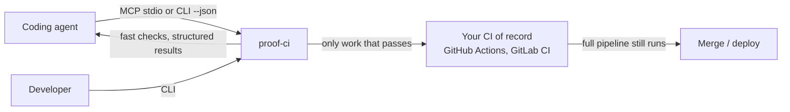
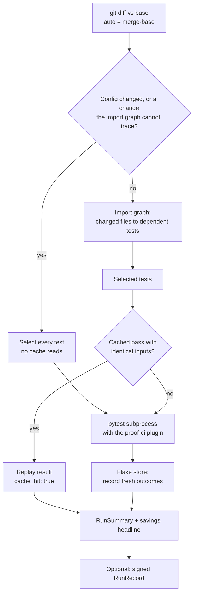
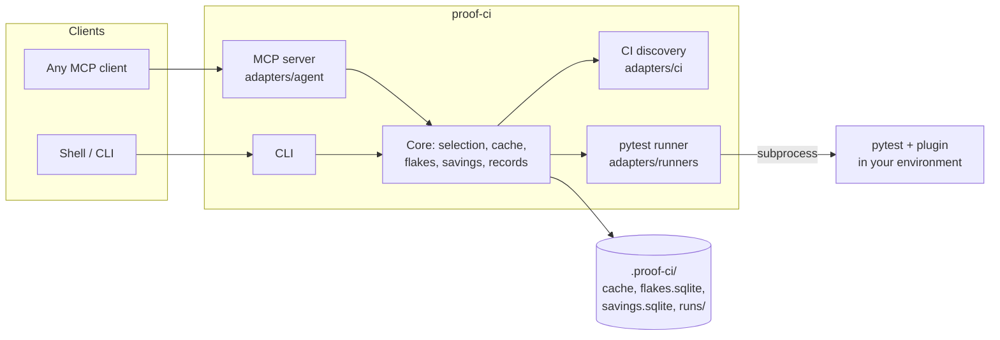
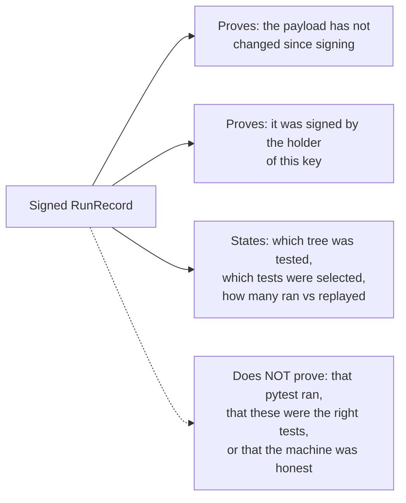

<p align="center">
  
</p>

# proof-ci

**Fast, structured, local test checks for coding agents.** proof-ci runs the tests a change can
actually break, tells the agent which failures are known flakes, hands back one structured failure
with a repro command instead of a log to scrape, and can sign a record of exactly what it checked.
It sits in front of your existing CI. It does not replace it.

Any agent that speaks MCP, or anything that can run a CLI and read JSON, can use it. Nothing in it
is tied to one agent, one git host, or one model provider.

> Status: Phase 1 (local CLI and MCP server). Linux, macOS, and native Windows are supported and
> tested in CI. Not yet on PyPI.

## What this is

What you get, in order of value:

1. **Tests the agent did not know to run.** proof-ci follows the Python import graph from the
   changed files to every test that depends on them, and runs those, conservatively.
2. **A flake-aware verdict.** A test that both passes and fails on unchanged code is flagged, so
   the agent stops rewriting good code to satisfy an unreliable test.
3. **One structured failure.** Test id, error, file and line, the likely cause inside the current
   diff, and a copy-paste repro command.
4. **A signed record of what was checked:** the tree hash, the selection, and how many results
   were run versus replayed from cache.
5. **Fewer wasted agent turns.** That is where the real time and money go.

### When it is worth installing

proof-ci pays off when the suite is big enough for selection to matter (roughly a full suite over a
minute), or when flaky tests and log-scraping are the pain. For a ten-second suite, the honest advice
is "just run pytest". `proof-ci savings calibrate` measures your suite and proof-ci's own overhead
and tells you which case you are in.

What you may already have, and how proof-ci differs:

| Tool | What it does | What it does not do |
| --- | --- | --- |
| `pytest --lf` | Reruns last failures, instantly | Misses regressions in tests that passed last time |
| `pytest-picked` | Runs changed test files | Misses tests that depend on changed source files |
| `pytest-testmon` | Selects by recorded coverage (precise, sees dynamic imports) | No structured output, no flake model, no record; slower measuring run |
| `pytest-xdist` | Runs tests in parallel | Complementary: proof-ci passes `-n` through |
| Hosted flake/test analytics | Classify flakes from CI history | Not a local, offline, one-call verdict for an agent |

## Run it in 60 seconds

proof-ci must be installed **into your project's own environment**, because pytest loads its plugin
from there. A tool-only install (pipx, `uv tool`) cannot see your project's dependencies, so it
does not work in Phase 1.

```bash
# in your project's virtualenv
pip install -e /path/to/proof-ci        # not on PyPI yet

proof-ci init                           # writes proof-ci.toml, .proof-ci/, .gitignore entries, a signing key
proof-ci run                            # run the tests affected by your change
proof-ci run --json                     # the same, as a RunSummary on stdout
proof-ci run --all                      # everything (also refreshes savings calibration)
proof-ci run --failed                   # rerun the last failures, with flake flags and structure
proof-ci flakes list                    # known flaky tests
proof-ci savings                        # what proof-ci saved: time and counts first
proof-ci run --sign                     # sign a record of this run
proof-ci record verify .proof-ci/runs/<run_id>/record.json --pubkey <key>.pub
proof-ci mcp                            # serve the six tools over stdio
```

Try it on the bundled demo (it has one deliberately failing test and one controllable flaky test):

```bash
cd examples/demo-project
proof-ci run --all        # exits 1 and reports tests/test_math.py::test_div_wrong_expectation
```

## How it works



Your existing CI stays the trust root for merges and deploys. proof-ci makes the inner loop fast and
structured, so only work worth promoting reaches the expensive pipeline.

### One run, step by step



- **When unsure, it runs the full suite.** A change to `pyproject.toml`, the root `conftest.py`, a
  lockfile, or CI config runs everything. So does a change the import graph cannot trace to a test:
  a Python file no collected test imports and nothing tests reach names (it may load as a plugin,
  by path, or in a subprocess), a module registered in pytest or project config, package data under
  a source root, and a data file named by non-test code. These full runs never replay the cache.
- **Code that tests launch is followed.** When a test runs a script as a subprocess, runs
  `python -m pkg`, or loads a directory by path, editing that script, or a module it imports, adds
  the tests that launch it (uncached) to the normal selection. A script nothing launches, such as a
  benchmark, does not widen the selection.
- **Full runs anchor later runs, green or red.** After a full run, later runs on the branch select
  normally until a full-run trigger changes again. Files that differ from the anchor run are
  selected even if they now match the base, and the anchor's failures always rerun, so a fix loop
  does not repeat the full suite and a red run never turns green by running less.
- **A test file that fails to import** selects only itself and is reported as an `error` result.
- **The base defaults to `auto`:** the merge-base with your default branch, so a committed change
  on a clean tree still selects the tests it affects. A run that selects nothing says why, and is
  never signed.
- **Data files** (including docs such as `README.md`) select the tests whose file mentions their
  name or path. A data file nothing names selects nothing. Dynamic imports
  (`importlib.import_module`) are handled conservatively, not completely.
- **`run --all` executes every test fresh,** never from the cache.
- **The cache** stores only passing, skipped, and xfail results, keyed by the test file, its import
  closure, the `conftest.py` chain, the pytest config, referenced data files, the interpreter, and
  the installed packages. Failures always re-run.
- **Savings headlines** lead with time and counts, for example
  `Checked 14/1,200 (12 cached) in 22s; flaky flagged 1; CI runs avoided 0; local test-min not run ~18`.
  Every figure is labelled measured or estimated with a confidence. Dollar amounts appear only after
  you set your own prices in `proof-ci.toml`. They are estimates, never invoices.

## Architecture in one picture



The core never imports a vendor SDK (an import-lint check in CI enforces this). Anything specific to
an agent product, a git host, a CI format, or a test runner lives in an adapter. More detail in
[docs/ARCHITECTURE.md](docs/ARCHITECTURE.md).

## Use it from an AI agent (MCP)

`proof-ci mcp` serves six tools over stdio: `run_affected_tests`, `get_failure_details`,
`explain_failure`, `list_flaky_tests`, `verify_record`, `get_savings_report`. Each returns one JSON
object.

The generic MCP stdio configuration is the same for every client (Claude Code, Cursor, Codex,
Windsurf, Cline, VS Code Copilot agent mode, and others):

```json
{
  "mcpServers": {
    "proof-ci": {
      "command": "proof-ci",
      "args": ["mcp"]
    }
  }
}
```

If your project's environment is not on the client's `PATH`, point at it directly. Native Windows
(JSON needs escaped backslashes; forward slashes also work):

```json
{
  "mcpServers": {
    "proof-ci": {
      "command": "C:\\path\\to\\project\\.venv\\Scripts\\proof-ci.exe",
      "args": ["mcp"]
    }
  }
}
```

or `"command": "C:/path/to/project/.venv/Scripts/python.exe", "args": ["-m", "proof_ci", "mcp"]`.
On Linux and macOS use `.venv/bin/proof-ci`. From a Windows client into WSL:

```json
{
  "mcpServers": {
    "proof-ci": {
      "command": "wsl.exe",
      "args": ["-d", "Ubuntu", "--cd", "/home/<user>/project", "-e", "/home/<user>/project/.venv/bin/proof-ci", "mcp"]
    }
  }
}
```

Agents identify themselves with generic variables: `PROOF_CI_AGENT_NAME`, `PROOF_CI_AGENT_VERSION`,
`PROOF_CI_AGENT_MODEL`, `PROOF_CI_AGENT_SESSION`, and `PROOF_CI_AGENT_ID` (or `--agent-id`).
Guidance written for agents is in [AGENTS.md](AGENTS.md).

## What a signed record proves



A record is a tamper-evident statement of what this proof-ci installation reported, attributable to
a key. In Phase 1 the signing key lives on the same machine as the agent, so treat a record as
attribution and integrity, not proof of execution. `proof-ci record verify` reports
`signer: "known"` only for keys you trust (`--pubkey`, or `[record].trusted_pubkeys`). Reviewers
should pass `--pubkey` obtained out of band, because a repository can list its own keys in its
config. `run --sign` refuses to sign a run that checked nothing, or one whose working tree changed
while the tests ran.

## The signing key

`proof-ci init` creates an Ed25519 key at the platform config location:

| Platform | Default key path |
| --- | --- |
| Linux | `~/.config/proof-ci/ed25519.pem` |
| macOS | `~/Library/Application Support/proof-ci/ed25519.pem` |
| Windows | `%LOCALAPPDATA%\proof-ci\ed25519.pem` |

Override with `PROOF_CI_SIGNING_KEY`, `--key`, or `[record].key_path`. The private key is created
owner-only (mode `0600` on Linux and macOS; an owner-only ACL via `icacls` on Windows), and proof-ci
refuses to sign with a key that other users can read. It is never printed, logged, or written into
a record.

### Where to keep the signing key

Keep it on a native filesystem. Some mounts cannot store file permissions and report every file as
world-readable: WSL2 `/mnt/c`, SMB/CIFS shares, many FUSE mounts, some NFS exports. On those proof-ci
loads the key with a warning when you own it. Inside WSL, keep it under `~/.config/proof-ci`, not
`/mnt/c`. In containers, mount a persistent key and set `PROOF_CI_SIGNING_KEY`; a fresh key in an
ephemeral home directory will never match your trusted keys (`proof-ci init --no-key` skips key
creation).

## Platform support

| Platform | Status | Notes |
| --- | --- | --- |
| Linux x86-64: Ubuntu 22.04+/Debian 12+, Fedora 40+/RHEL 9+, Arch | Supported, tested in CI | Needs Python 3.11+. Ubuntu 22.04 ships 3.10 and RHEL 8/9 default to older versions: use the distro's `python3.11`/`python3.12` package, deadsnakes, or `uv python install`. |
| Linux aarch64 | Expected to work; optional CI leg | Reported, not promised, until the ARM leg has been green for a release. |
| Alpine / musl | Expected to work, untested | |
| WSL2 | Supported as Linux | Keep the repository and the key inside the WSL filesystem, not `/mnt/c` (slower, case-insensitive, no file modes). Do not share one checkout between Windows and WSL. |
| Containers | Supported as Linux | Run with `--user $(id -u):$(id -g)` so `.proof-ci/` is not root-owned on the host. SQLite falls back from WAL mode on bind mounts. |
| macOS 13+ (Apple silicon and Intel) | Supported, tested in CI | |
| Windows 10 and 11, x64 | Supported, tested in CI | Native, not WSL-only. For deep repositories run `git config core.longpaths true`. |
| Windows on ARM | Expected to work, untested | |
| FreeBSD, OpenBSD | Unsupported | |

Requires git 2.0 or newer.

## Limits, stated plainly

- **Not a CI replacement.** Your CI still runs the full pipeline. A green proof-ci run is not a
  reason to skip it.
- **Not a security sandbox.** `proof-ci run` executes your tests with the same privileges as
  `pytest`. Repository content (tests, conftest files, CI YAML) is treated as data, never as
  instructions to proof-ci, but your tests still run as you.
- **Python and pytest only** in Phase 1. `test_command` must be a pytest invocation; discovery may
  suggest `tox` or `make test`, but proof-ci will not execute them.
- **Selection can still under-select** when a test reaches code through a path that leaves no trace
  in the source: a module name built at runtime, a file read through a computed path, or a test
  that depends on files outside the repository. Untraceable changes the graph can see force a full
  run, but static analysis is not complete. Your CI's full run remains the backstop.
- **Source edits often select most of the suite.** In a package where most tests import the
  package's top level, editing almost any module selects nearly every test. proof-ci then helps by
  structure, flake flags, and replaying unchanged results, not by running fewer tests.
- **Some inputs are not tracked.** Environment variables are not part of the cache key, so a cached
  pass is replayed even if a variable the test reads has changed (use `--no-cache` or `--all`).
- **Flakes are judged on identical trees.** A test is flagged flaky only when it passes and fails on
  the same working tree, so an edit and its revert never look like a flip. Flake detection therefore
  needs repeated runs without edits in between.
- **The test process is trusted.** Tests and `conftest.py` run inside the same pytest process that
  reports results, so hostile test code could report anything. A record states what proof-ci
  reported; it cannot vouch for the test code itself.
- **Redaction of secrets in captured output is best effort,** not a guarantee.
- **Savings are estimates.** Local minutes are your machine's time, not CI time, and are unpriced by
  default. Token figures are measured against pytest's real output and are often negative on small
  green runs.

## What this is not

Not a test framework, not a build system, not an agent, not an automatic repair tool, not a secrets
manager, and not a hosted service (yet). It runs checks and returns structured facts.

## Configuration

`proof-ci init` writes `proof-ci.toml` with every key and its default. The ones you are most likely
to change:

```toml
[project]
test_command = ["pytest"]        # or ["python", "-m", "pytest"]; an array, so Windows paths need no quoting
pytest_args = []                 # e.g. ["-n", "auto"] for pytest-xdist
source_roots = ["src"]
test_paths = ["tests"]

[affected]
base = "auto"                    # merge-base with the default branch; or "HEAD", or any ref

[record]
trusted_pubkeys = []             # public keys whose records verify as signer "known"

[savings]
# Prices are commented out on purpose: a fresh install shows time, not money.
# ci_cost_per_minute = 0.01
```

`proof-ci init --discover` reads your GitHub Actions or GitLab CI files (read-only; nothing is
executed) and writes the pytest command it finds. `proof-ci discover` lists what it found.

## For developers

```bash
python -m venv .venv
.venv/bin/pip install -e ".[dev]"          # Windows: .venv\Scripts\pip install -e ".[dev]"
ruff check src tests && ruff format --check src tests
mypy
lint-imports
pytest
```

CI runs the same steps on Linux, macOS, and Windows with Python 3.11 to 3.13; see
[docs/CI.md](docs/CI.md). The build specification lives in
[docs/spec/proof-ci_build_spec.md](docs/spec/proof-ci_build_spec.md). Before a release, walk
[docs/CROSS_AGENT_CHECKLIST.md](docs/CROSS_AGENT_CHECKLIST.md) in at least two different agents.

## License

MIT. Copyright (c) 2026 SMRFORGE LLC.
