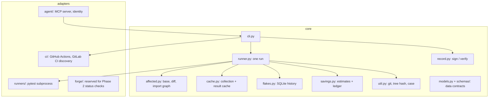

# Architecture

proof-ci is a vendor-free core plus adapters. The core owns selection, caching, flakes, savings,
signing, configuration, and orchestration. Adapters own anything specific to an agent product, a git
host, a CI configuration format, or a test runner. An import-lint contract and an AST test keep
vendor SDKs (and the MCP library) out of the core.



## Modules

| Module | Responsibility |
| --- | --- |
| `cli.py` | Typer commands; `--json`, `--repo`, `--config` on every leaf command; exit codes 0-4 |
| `config.py` | `proof-ci.toml` loading, defaults, repo-root discovery, `init` |
| `runner.py` | One run: selection plan, cache lookup, pytest, flakes, savings, artifacts |
| `affected.py` | Base resolution, changed files, fallback globs (incremental), import graph, likely cause |
| `cache.py` | Collection cache and result cache (RFC 8785 + SHA-256 keys), LRU trim |
| `flakes.py` | Outcome history, flake detection and transitions, manual marks |
| `savings.py` | Calibration, per-run Savings object, ledger, reports |
| `record.py` | Canonicalisation, Ed25519 keys and protection, sign, verify |
| `discover.py` | Facade over CI command sources |
| `pytest_plugin.py` | Loaded with `-p` inside pytest; stdlib + pytest only |
| `models.py`, `schemas/` | Pydantic models mirroring the JSON Schema contracts |

## Run artifacts

```
.proof-ci/
  cache/              result cache (passed, skipped, xfailed, xpassed; never failures)
  collect-cache/      cached pytest collection
  flakes.sqlite       outcome history and flake records
  savings.sqlite      savings ledger and calibration
  last-run.json       the latest RunSummary
  runs/<run_id>/      summary.json, results.json, environment.json,
                      pytest-stdout.txt, collect.json, plugin-results.json, record.json
```

## Why pytest runs as a subprocess

The project's test command may use a different interpreter than proof-ci; the MCP server is long
lived and repeated in-process pytest runs leak state; and a crashing test must not take the server
down. The plugin writes JSON to a file named by an environment variable, and the runner never parses
pytest's stdout for results. Child processes get an empty stdin, because the MCP server's stdin is
its protocol transport.

## Data contracts

The JSON Schemas in `src/proof_ci/schemas/` are the compatibility boundary (`schema_version`
`1.0.0`). Tests check that the schemas match the build specification byte for byte, and that the
Pydantic models accept and reject the same inputs as the schemas.
